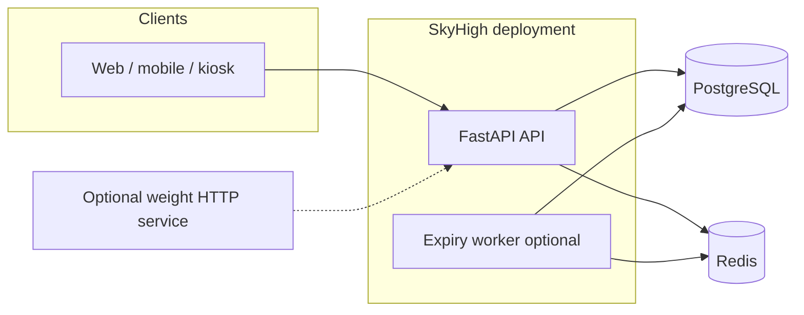
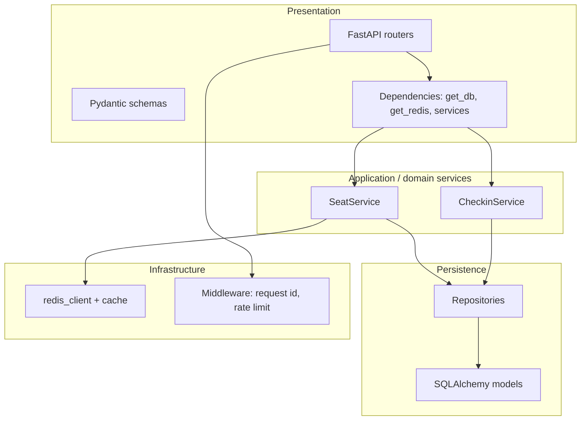
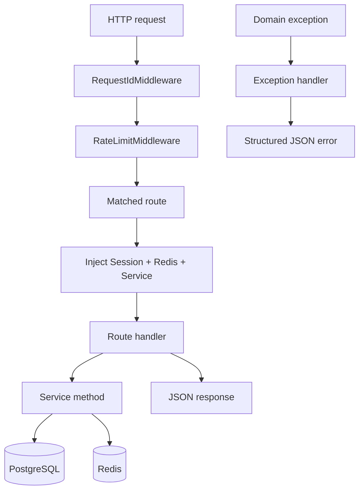
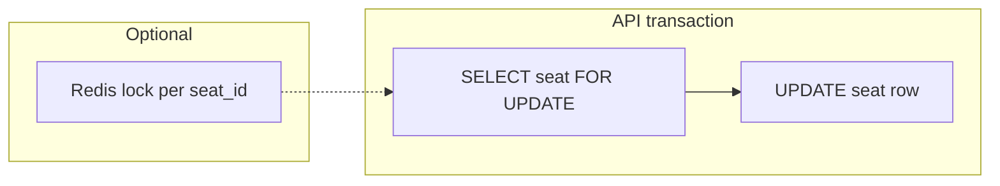

# Architecture

SkyHigh Core is a **modular monolith**: one deployable Python process (FastAPI) with clear internal layers, backed by **PostgreSQL** and **Redis**, plus optional **separate worker processes** for background expiry.

## 1. High-level system context

- **PostgreSQL:** authoritative state for flights, passengers, seats, check-in sessions, idempotency keys.
- **Redis:** seat-map cache, rate-limit counters, optional seat locks, cache invalidation lists.
- **Worker:** batch seat expiry; does not replace DB locking in the API.

## 2. Application layering (hexagonal-style)

**Dependency rule:** routers depend on services and schemas; services depend on repositories and infrastructure ports; repositories depend on ORM/session. This keeps HTTP concerns separate from business rules.

## 3. Request path through the API

- **Rate limiting** applies to `/api/v1/*` except health routes when enabled; Redis failures **fail open** (request continues, warning logged).
- **Exception handlers** in `main.py` map domain exceptions to **404 / 409 / 429 / 502** with a stable `error` code and `message`.

## 4. Concurrency model (seats)

- **Primary mutex:** PostgreSQL row lock on the seat during hold/confirm.
- **Secondary:** optional Redis lock to serialize entrants before hitting the DB (configurable).

## 5. Caching strategy

| Data | Key pattern | Invalidation |
|------|-------------|--------------|
| Seat map per flight | Configured via cache helper (e.g. `seat_map:{flight_id}`) | After hold/confirm and after batch expiry updates |

On cache miss or Redis error during read, the service falls back to **database** for the seat list.

## 6. Deployment topology (Docker Compose)

The repository includes a **reference** Compose stack:

- **`api`** — Uvicorn-served FastAPI app, depends on healthy Postgres + Redis.
- **`expiry-worker`** — runs `python -m skyhigh.workers.expiry_loop` with the same DB/Redis URLs.
- **`postgres`**, **`redis`** — data stores.

Production would typically add: TLS termination, secrets management, migration job or init container, metrics, and backups—outside the scope of this minimal compose file.

## 7. Configuration

All environment-driven behavior is centralized in `skyhigh.config.Settings` (loaded from `.env` and the environment). See [README.md](README.md) for the variable table.

## 8. Related documents

| Document | Focus |
|----------|--------|
| [PROJECT_STRUCTURE.md](PROJECT_STRUCTURE.md) | Folders and modules |
| [WORKFLOW_DESIGN.md](WORKFLOW_DESIGN.md) | Flows and schema narrative |
| [API-SPECIFICATION.md](API-SPECIFICATION.md) | HTTP endpoints |
| [PRD.md](PRD.md) | Product goals and NFRs |
