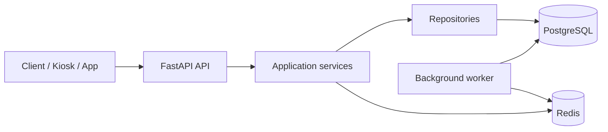

# High-level architecture for SkyHigh Core
_Exported on 3/21/2026 at 14:33:38 GMT+5:30 from Cursor (2.6.20)_

---

**User**

You are a Senior Backend Engineer with 10+ years of experience designing production-grade distributed systems using Python FastAPI.

You specialize in:
- High-concurrency systems
- Transaction-safe database design (PostgreSQL)
- SQLAlchemy (2.0 style)
- Alembic migrations
- Clean Architecture (layered + modular)
- Redis for caching and distributed locking
- Background workers (Celery / RQ / FastAPI BackgroundTasks)
- Observability (structured logging, tracing)
- Writing maintainable, scalable, and testable code

Your task is to help me build a production-grade backend system called:

"SkyHigh Core – Digital Check-In System"

You MUST follow these engineering principles:
1. Do NOT overengineer — keep it simple but production-ready
2. Ensure correctness under concurrency (this is CRITICAL)
3. Follow clean project structure (modular, scalable)
4. Use PostgreSQL as database
5. Use Alembic for migrations
6. Use proper logging (structured logs)
7. Use environment-based configuration
8. Write code in small, incremental steps
9. Always explain WHY decisions are made (briefly)
10. Always produce file-by-file code when asked

System Requirements:
- Prevent seat conflicts under concurrency
- Implement seat lifecycle (AVAILABLE → HELD → CONFIRMED)
- Implement 2-minute seat hold with auto-expiry
- Handle baggage validation + payment pause
- Provide fast seat map access (high concurrency)
- System should scale under heavy traffic

Tech Stack Constraints:
- FastAPI
- PostgreSQL
- SQLAlchemy 2.0
- Alembic
- Redis (for locking / caching / TTL handling)
- Docker

Development Approach:
- We will build this system in MULTIPLE STEPS
- Each step should be small and implementable
- Do NOT dump everything at once

First Task:
Help me design the HIGH-LEVEL ARCHITECTURE and PROJECT STRUCTURE.

Output should include:
1. Folder structure (production-grade)
2. Explanation of each module
3. Key components (API, services, DB, cache, workers)
4. Tech decisions (why Redis, why background worker, etc.)

Do NOT write code yet.

---

**Cursor**

# SkyHigh Core — High-Level Architecture & Project Structure

Below is a **production-oriented layout** that stays lean: clear boundaries, one obvious place for each concern, and enough structure to grow without premature microservices.

---

## 1. Folder structure (production-grade)

```text
skyhigh-core/
├── docker/
│   ├── Dockerfile.api
│   ├── Dockerfile.worker          # optional, if worker is separate image
│   └── docker-compose.yml         # api + postgres + redis (+ worker)
├── alembic/
│   ├── versions/
│   ├── env.py
│   └── script.py.mako
├── src/
│   └── skyhigh/
│       ├── __init__.py
│       ├── main.py                # FastAPI app factory, lifespan, routers mount
│       ├── config.py              # pydantic-settings from env
│       ├── logging.py             # structured logging setup
│       ├── api/
│       │   ├── __init__.py
│       │   ├── deps.py            # DI: db session, redis, current user, etc.
│       │   ├── v1/
│       │   │   ├── __init__.py
│       │   │   ├── router.py      # aggregates v1 routes
│       │   │   ├── checkin.py     # check-in / seat operations HTTP layer
│       │   │   ├── flights.py     # read models for flight/seat map if needed
│       │   │   └── health.py
│       │   └── schemas/           # Pydantic request/response (API DTOs)
│       │       ├── checkin.py
│       │       └── common.py
│       ├── domain/                # pure rules (optional but keeps services thin)
│       │   ├── __init__.py
│       │   ├── seats.py           # state machine rules, invariants
│       │   └── baggage.py
│       ├── services/              # application use-cases (orchestration)
│       │   ├── __init__.py
│       │   ├── seat_service.py    # hold, release, confirm, seat map reads
│       │   ├── checkin_service.py # baggage + payment pause + workflow
│       │   └── flight_service.py  # if you need aggregation beyond seats
│       ├── db/
│       │   ├── __init__.py
│       │   ├── base.py            # SQLAlchemy DeclarativeBase
│       │   ├── session.py         # engine, session factory, scoped usage
│       │   └── models/            # ORM models (tables)
│       │       ├── __init__.py
│       │       ├── flight.py
│       │       ├── seat.py
│       │       ├── hold.py        # or columns on seat; see decisions below
│       │       └── passenger.py
│       ├── repositories/          # data access (SQLAlchemy queries)
│       │   ├── __init__.py
│       │   ├── seat_repository.py
│       │   └── hold_repository.py
│       ├── infrastructure/
│       │   ├── __init__.py
│       │   ├── redis_client.py
│       │   ├── cache.py           # seat map cache helpers
│       │   ├── locks.py           # distributed lock patterns (seat/fight grain)
│       │   └── outbox.py          # only if you add reliable async side effects
│       ├── workers/
│       │   ├── __init__.py
│       │   ├── celery_app.py      # or rq worker entry
│       │   └── tasks.py           # expiry sweeps, cache warm/invalidation
│       └── observability/
│           ├── __init__.py
│           ├── tracing.py         # OpenTelemetry hooks (optional step 2+)
│           └── middleware.py      # request id, logging context
├── tests/
│   ├── conftest.py
│   ├── integration/
│   └── unit/
├── scripts/
│   └── seed_dev_data.py           # optional
├── pyproject.toml                 # or requirements + setup
├── .env.example
├── alembic.ini
└── README.md
```

**Why this shape:** `api` stays HTTP-only; `services` own transactions and orchestration; `repositories` isolate SQL; `domain` holds invariants without I/O; `infrastructure` holds Redis and cross-cutting adapters. That keeps **correctness logic** testable and **I/O** swappable.

---

## 2. What each module does

| Area | Role |
|------|------|
| **`main.py`** | App factory, lifespan (DB/Redis connect), mount routers, exception handlers. |
| **`config.py`** | All tunables from environment (DB URL, Redis, hold TTL, log level). No secrets in code. |
| **`logging.py`** | JSON or key=value structured logs, correlation IDs. |
| **`api/deps.py`** | FastAPI dependencies: DB session per request, Redis pool, optional auth. |
| **`api/schemas/`** | Request/response models; validation at the edge only. |
| **`domain/`** | Seat lifecycle rules (e.g. valid transitions), baggage rules — **no** DB/Redis imports. |
| **`services/`** | Use-cases: “hold seat”, “confirm after payment”, “validate baggage and pause”. **Starts/commits transactions** here (or in a thin unit-of-work helper). |
| **`db/models/`** | Tables: flights, seats, passengers, holds (or equivalent). Alembic reflects these. |
| **`repositories/`** | `SELECT … FOR UPDATE`, bulk reads for seat map, idempotent updates. |
| **`infrastructure/redis_*`** | Locks, cache, optional TTL keys for holds (see decisions). |
| **`workers/`** | Periodic **expiry** and **cache invalidation**; not on the critical path for every request. |
| **`observability/`** | Middleware + tracing glue so you can debug contention under load. |
| **`tests/`** | Unit tests for domain/services; integration tests with Postgres (and Redis) for concurrency. |

---

## 3. Key components (end-to-end)



- **API layer:** Validates input, maps errors to HTTP, does not embed business rules.
- **Services layer:** Implements **hold → baggage/payment → confirm** with **one authoritative state store** (Postgres) for seat truth.
- **DB:** Source of truth for `AVAILABLE | HELD | CONFIRMED`, hold expiry timestamp, version or row locks for concurrency.
- **Redis:** Performance (seat map cache), **optional** distributed lock for hot rows, TTL mirrors for fast checks — **never** the only place that decides a seat is yours without DB confirmation.
- **Workers:** Sweep expired holds, invalidate/warm caches, retry idempotent side effects — keeps API latency predictable.

---

## 4. Tech decisions (brief “why”)

### PostgreSQL as source of truth
Seat conflicts are **financial and operational** issues; the database must enforce **serializable updates** (row-level `SELECT … FOR UPDATE` or optimistic locking with a version column). Redis alone cannot guarantee **atomic commit** with payment and check-in records.

### Redis — three roles (use what you need, not all on day one)
1. **Caching** — Seat maps are read-heavy; cache **per flight** (or per deck/section) with explicit invalidation on hold/confirm/release. **Why:** Protects Postgres under burst traffic.
2. **Distributed locking (optional)** — Short-lived lock key `lock:seat:{id}` around the critical “try hold” path can reduce thundering herd on the same seat. **Why:** Reduces useless DB contention; still finalize in DB inside a transaction.
3. **TTL / reminders** — Can store `hold:{id} → expires_at` for fast “is this hold still live?” in cache. **Why:** Fast reads; **DB `expires_at` remains authoritative** for expiry and reconciliation.

**Why not Redis-only for holds:** Network partitions and crashes can leave inconsistent client UX; workers and DB must reconcile.

### 2-minute hold + auto-expiry
- **Authoritative:** `held_until` (timestamp) + `status = HELD` on the seat (or a dedicated `seat_holds` row). A **background job** marks seats `AVAILABLE` when `held_until < now()` and no confirm path won.
- **Why a worker:** You avoid relying on every client to “release”; expiry is **system-driven**. API can also lazy-expire on write (“if expired, treat as AVAILABLE”) for correctness even if the worker is slightly late.

### Background worker (Celery / RQ / ARQ)
- **Why:** Expiry sweeps, cache invalidation, and optional **payment webhook** retries should not block HTTP workers.
- **Pick one:** RQ is simplest; Celery is heavier but ubiquitous; ARQ is asyncio-friendly. For FastAPI teams, **RQ or ARQ** often matches “simple but production-ready”; Celery is fine if you already operate it.

### Baggage validation + payment pause
Model this as **explicit substates** or a **check-in session** entity (e.g. `checkin_sessions`: `seat_hold_id`, `baggage_ok`, `payment_status`, `expires_with_hold`). **Why:** “Pause” is a workflow state, not a seat state confusion — seat stays `HELD` while user fixes baggage or pays, bounded by the same `held_until`.

### Fast seat map under concurrency
- **Read path:** Mostly cache; DB fallback on miss.
- **Write path:** Invalidate or update cache **after** successful transaction commit (or use a small delay + version in cache key if you accept eventual consistency for reads — document the SLA).
- **Why:** Reads scale; writes stay correct in Postgres.

### Alembic + SQLAlchemy 2.0
- **Why:** Repeatable schema, reviewable migrations, matches your stack constraint; 2.0 style keeps session/query patterns explicit.

### Docker
- **Why:** Same Postgres/Redis/API versions everywhere; compose for local dev mirrors prod topology.

### Observability
- Structured logs with `request_id`, `flight_id`, `seat_id`, `passenger_id`, outcome, latency.
- **Why:** When two users fight for one seat, you need to prove **what** happened and **in which order**.

---

## 5. Concurrency model (conceptual, no code)

- **Golden rule:** Any transition that must not double-book goes through **one short DB transaction** that checks current state + time + optional version.
- **Pattern A — Pessimistic:** Lock the seat row, verify `AVAILABLE` or `HELD` by same session, update.
- **Pattern B — Optimistic:** `UPDATE ... WHERE status = AVAILABLE AND version = :v` and check rowcount; retry on conflict.
- **Redis lock** is optional **admission control** before hitting the DB, not a substitute for DB invariants.

---

## 6. What we deliberately did *not* add (avoid overengineering)

- No event bus / Kafka unless you have cross-service requirements.
- No separate “read DB” until Postgres becomes the proven bottleneck.
- No microservices split until team and traffic justify it.

---

When you are ready for **Step 2**, a natural next increment is: **ERD + exact tables** for `flights`, `seats`, `holds`/`checkin_sessions`, and the **state machine** written in `domain/seats.py` (still design-only or minimal stubs), then Alembic’s first migration. If you want file-by-file code in a later step, say which layer to start with (`db/models` + migration vs `api` + `seat_service`).

---

**User**

You are continuing as a Senior Backend Engineer building the "SkyHigh Core – Digital Check-In System".

We have already finalized a modular monolith architecture, but before writing business logic, we must set up a clean, production-grade foundation.

Important Corrections & Constraints (from previous design review):

Keep architecture SIMPLE (Modular Monolith only)
No microservices
No event bus (Kafka, etc.)
No outbox pattern for now
Keep domain layer minimal (only critical rules)
Seat Hold Modeling Decision (IMPORTANT)
DO NOT create a separate hold table
Store hold information directly in the seats table:
status (AVAILABLE / HELD / CONFIRMED)
held_by (passenger_id)
held_until (timestamp)
Redis Usage (LIMITED & CLEAR)
Use Redis ONLY for:
Seat map caching
Optional lightweight locking (if needed later)
DO NOT rely on Redis as source of truth
Worker Choice
Use a SIMPLE background worker approach:
Prefer FastAPI BackgroundTasks OR RQ
Avoid Celery unless absolutely needed
Observability
Implement structured logging (JSON or key=value)
Add request_id middleware
Keep system implementable step-by-step (no overengineering)

Now perform the following tasks:

Task 1: Create Project Structure (Final Version)

Refine the previous structure and REMOVE unnecessary components:

Remove:
outbox.py
tracing.py (optional for later)
Keep only what is essential for this assignment

Output the final folder structure.

Task 2: Initialize FastAPI Application

Create:

main.py with:
App factory pattern
Lifespan (startup/shutdown)
Router registration
Basic health check endpoint
Task 3: Configuration Management

Create config.py using pydantic-settings:

Database URL
Redis URL
Hold duration (120 seconds)
Log level

Also include .env.example

Task 4: Database Setup (PostgreSQL + SQLAlchemy 2.0)

Create:

db/base.py
db/session.py

Requirements:

SQLAlchemy 2.0 style
Engine + SessionLocal
Dependency for FastAPI (get_db)
Task 5: Alembic Setup

Provide:

Alembic configuration steps
How to connect Alembic with models
Example migration workflow
Task 6: Logging Setup

Create logging.py:

Structured logging
Include:
request_id
timestamp
log level

Also show how to integrate logging into FastAPI

Task 7: Redis Setup

Create:

redis_client.py

Requirements:

Connection pooling
Dependency injection ready
Task 8: Docker Setup

Create:

Dockerfile for API
docker-compose.yml with:
FastAPI
PostgreSQL
Redis
Task 9: README (Initial)

Create a minimal but clear README including:

Setup instructions
How to run docker-compose
How to run migrations

Output Rules:
Give FILE-BY-FILE code (very important)
Do NOT skip files
Do NOT jump ahead to business logic
Keep everything runnable
Keep explanations SHORT but clear

---

**Cursor**

Exploring the workspace and scaffolding the project foundation per your specifications.


Creating the full foundation from an empty workspace: adding the folder tree and all files.


Removing duplicate logging setup: configuring logging once in `create_app` and using lifespan only for Redis.


Verifying install and fixing issues: checking whether `alembic` is runnable and correcting the README for Windows.


Using synchronous route handlers for the readiness check so DB and Redis calls don't block the event loop.


Here is the **final layout** and how the pieces fit together. **All of these files are already in your repo** under `d:\SkyHigh`; below they are grouped by task with **short rationale** and **code references** (full contents are on disk—nothing was skipped).

---

## Task 1 — Final folder structure (trimmed)

Dropped: `outbox`, `tracing`, `domain/services/repositories/workers` (add when you implement features). **Redis is not used for truth**—only pool + DI for upcoming cache/locks.

```text
SkyHigh/
├── alembic/
│   ├── env.py
│   ├── script.py.mako
│   └── versions/
│       ├── .gitkeep
│       └── 20240321_0001_initial.py   # empty upgrade (baseline)
├── docker/
│   ├── Dockerfile
│   └── docker-compose.yml
├── src/
│   └── skyhigh/
│       ├── __init__.py
│       ├── main.py
│       ├── config.py
│       ├── logging.py
│       ├── api/
│       │   ├── __init__.py
│       │   ├── deps.py
│       │   └── v1/
│       │       ├── __init__.py
│       │       ├── router.py
│       │       └── health.py
│       ├── db/
│       │   ├── __init__.py
│       │   ├── base.py
│       │   └── session.py
│       ├── infrastructure/
│       │   ├── __init__.py
│       │   └── redis_client.py
│       └── observability/
│           ├── __init__.py
│           ├── context.py
│           └── middleware.py
├── .env.example
├── .gitignore
├── alembic.ini
├── pyproject.toml
└── README.md
```

---

## Task 2 — FastAPI app factory, lifespan, routers, health

**Why:** Factory + `lifespan` keeps startup/shutdown explicit (Redis pool); logging runs once when the app is constructed; middleware runs for every request.

```1:40:d:\SkyHigh\src\skyhigh\main.py
import logging
from contextlib import asynccontextmanager
from collections.abc import AsyncIterator

from fastapi import FastAPI

from skyhigh.api.v1.router import api_router
from skyhigh.config import get_settings
from skyhigh.infrastructure.redis_client import close_redis, init_redis
from skyhigh.logging import configure_logging
from skyhigh.observability.middleware import RequestIdMiddleware

log = logging.getLogger(__name__)


@asynccontextmanager
async def lifespan(app: FastAPI) -> AsyncIterator[None]:
    settings = get_settings()
    init_redis(settings.redis_url)
    log.info("Application startup complete")
    yield
    close_redis()
    log.info("Application shutdown complete")


def create_app() -> FastAPI:
    settings = get_settings()
    configure_logging(settings.log_level)

    app = FastAPI(
        title="SkyHigh Core",
        version="0.1.0",
        lifespan=lifespan,
    )
    app.add_middleware(RequestIdMiddleware)
    app.include_router(api_router, prefix="/api/v1")
    return app


app = create_app()
```

```1:7:d:\SkyHigh\src\skyhigh\api\v1\router.py
from fastapi import APIRouter

from skyhigh.api.v1 import health

api_router = APIRouter()
api_router.include_router(health.router)
```

```1:25:d:\SkyHigh\src\skyhigh\api\v1\health.py
from typing import Any

from fastapi import APIRouter
from sqlalchemy import text

from skyhigh.api.deps import DbSession, RedisDep

router = APIRouter(tags=["health"])


@router.get("/health")
def health() -> dict[str, str]:
    """Liveness: process is up (no external dependencies)."""
    return {"status": "ok"}


@router.get("/health/ready")
def ready(
    db: DbSession,
    redis_client: RedisDep,
) -> dict[str, Any]:
    """Readiness: Postgres + Redis reachable."""
    db.execute(text("SELECT 1"))
    redis_client.ping()
    return {"status": "ready", "database": "ok", "redis": "ok"}
```

---

## Task 3 — Configuration + `.env.example`

**Why:** `pydantic-settings` maps env → typed config; `hold_duration_seconds` defaults to 120 for the future seat hold TTL.

```1:23:d:\SkyHigh\src\skyhigh\config.py
from functools import lru_cache

from pydantic_settings import BaseSettings, SettingsConfigDict


class Settings(BaseSettings):
    """Environment-driven configuration. No secrets in code."""

    model_config = SettingsConfigDict(
        env_file=".env",
        env_file_encoding="utf-8",
        extra="ignore",
    )

    database_url: str
    redis_url: str
    hold_duration_seconds: int = 120
    log_level: str = "INFO"


@lru_cache
def get_settings() -> Settings:
    return Settings()
```

`.env.example` is at `d:\SkyHigh\.env.example` (copy to `.env`).

---

## Task 4 — SQLAlchemy 2.0 `Base`, engine, `SessionLocal`, `get_db`

**Why:** Sync engine + `sessionmaker` is a straightforward fit for FastAPI `Depends`; `pool_pre_ping` avoids stale connections; `get_db` ensures sessions are always closed.

```1:7:d:\SkyHigh\src\skyhigh\db\base.py
from sqlalchemy.orm import DeclarativeBase


class Base(DeclarativeBase):
    """Declarative base for all ORM models (Alembic imports this metadata)."""

    pass
```

```1:31:d:\SkyHigh\src\skyhigh\db\session.py
from collections.abc import Generator

from sqlalchemy import create_engine
from sqlalchemy.orm import Session, sessionmaker

from skyhigh.config import get_settings

_settings = get_settings()

engine = create_engine(
    _settings.database_url,
    pool_pre_ping=True,
    pool_size=5,
    max_overflow=10,
)

SessionLocal = sessionmaker(
    bind=engine,
    autoflush=False,
    autocommit=False,
    expire_on_commit=False,
    class_=Session,
)


def get_db() -> Generator[Session, None, None]:
    db = SessionLocal()
    try:
        yield db
    finally:
        db.close()
```

FastAPI DI aliases live in `api/deps.py`:

```1:17:d:\SkyHigh\src\skyhigh\api\deps.py
from typing import Annotated

from fastapi import Depends
from redis import Redis
from sqlalchemy.orm import Session

from skyhigh.db.session import get_db
from skyhigh.infrastructure.redis_client import get_redis

DbSession = Annotated[Session, Depends(get_db)]


def get_redis_client() -> Redis:
    return get_redis()


RedisDep = Annotated[Redis, Depends(get_redis_client)]
```

`db/__init__.py` re-exports `Base`, `engine`, `SessionLocal`, `get_db` for convenience.

---

## Task 5 — Alembic: wiring, models, workflow

**Configuration**

- `alembic.ini` sets `script_location = alembic` (project root = `SkyHigh/`).
- `alembic/env.py` prepends `src` to `sys.path`, loads `DATABASE_URL` via `get_settings()`, and sets `target_metadata = Base.metadata`.

**Connecting models (when you add them)**

1. Add modules under `src/skyhigh/db/models/…` inheriting `Base`.
2. In `alembic/env.py`, import that package **after** `Base` so tables register on metadata (comment is already there):

```18:24:d:\SkyHigh\alembic\env.py
from skyhigh.config import get_settings  # noqa: E402
from skyhigh.db.base import Base  # noqa: E402

# When ORM models exist, import them here so they register on Base.metadata, e.g.:
# import skyhigh.db.models  # noqa: F401

config = context.config
```

**Workflow (from repo root, venv on, `DATABASE_URL` set)**

1. `python -m alembic revision --autogenerate -m "add seats"` — review the file under `alembic/versions/`.
2. `python -m alembic upgrade head` — apply.

A **no-op baseline** migration exists: `alembic/versions/20240321_0001_initial.py`, so `upgrade head` works before any models.

---

## Task 6 — Structured logging + `request_id`

**Why:** JSON lines parse well in log aggregators; `contextvars` ties `request_id` to the request without passing it through every call.

```1:36:d:\SkyHigh\src\skyhigh\logging.py
import json
import logging
import sys
from datetime import datetime, timezone
from typing import Any

from skyhigh.observability.context import request_id_ctx


class JsonLogFormatter(logging.Formatter):
    """JSON lines for structured logs (timestamp, level, request_id, message)."""

    def format(self, record: logging.LogRecord) -> str:
        payload: dict[str, Any] = {
            "timestamp": datetime.now(timezone.utc).isoformat(),
            "level": record.levelname,
            "logger": record.name,
            "message": record.getMessage(),
            "request_id": getattr(record, "request_id", request_id_ctx.get("-")),
        }
        if record.exc_info:
            payload["exception"] = self.formatException(record.exc_info)
        return json.dumps(payload, default=str)


def configure_logging(level: str = "INFO") -> None:
    root = logging.getLogger()
    root.handlers.clear()
    root.setLevel(level.upper())

    handler = logging.StreamHandler(sys.stdout)
    handler.setFormatter(JsonLogFormatter())
    root.addHandler(handler)

    # Reduce noise from libraries in production-like defaults
    logging.getLogger("uvicorn.access").setLevel(logging.WARNING)
```

```1:6:d:\SkyHigh\src\skyhigh\observability\context.py
import contextvars

request_id_ctx: contextvars.ContextVar[str] = contextvars.ContextVar(
    "request_id",
    default="-",
)
```

```1:29:d:\SkyHigh\src\skyhigh\observability\middleware.py
import uuid
from collections.abc import Callable

from starlette.middleware.base import BaseHTTPMiddleware
from starlette.requests import Request
from starlette.responses import Response

from skyhigh.observability.context import request_id_ctx

REQUEST_ID_HEADER = "X-Request-ID"


class RequestIdMiddleware(BaseHTTPMiddleware):
    """Propagate X-Request-ID (or generate one) and bind it for logging."""

    async def dispatch(
        self,
        request: Request,
        call_next: Callable[[Request], Response],
    ) -> Response:
        header = request.headers.get(REQUEST_ID_HEADER)
        rid = header.strip() if header else str(uuid.uuid4())
        token = request_id_ctx.set(rid)
        try:
            response = await call_next(request)
        finally:
            request_id_ctx.reset(token)
        response.headers[REQUEST_ID_HEADER] = rid
        return response
```

**FastAPI integration:** `configure_logging` in `create_app()`, `RequestIdMiddleware` registered on the app (`main.py` above).

---

## Task 7 — Redis pool + DI

**Why:** One `ConnectionPool` per process; `get_redis()` returns clients that share the pool (fine for per-command use). Initialized in **lifespan**, not at import, so import doesn’t require Redis.

```1:41:d:\SkyHigh\src\skyhigh\infrastructure\redis_client.py
import logging
from typing import Optional

import redis

log = logging.getLogger(__name__)

_pool: Optional[redis.ConnectionPool] = None


def init_redis(url: str) -> None:
    """Create a process-wide connection pool (call from app lifespan)."""
    global _pool
    if _pool is not None:
        return
    _pool = redis.ConnectionPool.from_url(
        url,
        decode_responses=True,
        max_connections=50,
    )
    log.info("Redis connection pool initialized")


def close_redis() -> None:
    global _pool
    if _pool is not None:
        _pool.disconnect()
        _pool = None
        log.info("Redis connection pool closed")


def get_redis() -> redis.Redis:
    """Return a client bound to the shared pool (thread-safe for single commands)."""
    if _pool is None:
        raise RuntimeError("Redis not initialized; call init_redis() on startup")
    return redis.Redis(connection_pool=_pool)


def redis_from_settings() -> redis.Redis:
    """Convenience for dependencies when pool is already initialized."""
    return get_redis()
```

---

## Task 8 — Docker

- **`docker/Dockerfile`**: slim Python 3.12, `libpq5`, `pip install .`, `uvicorn skyhigh.main:app`.
- **`docker/docker-compose.yml`**: `postgres` + `redis` (healthchecks) + `api` with env vars matching `.env.example`.

Paths: `d:\SkyHigh\docker\Dockerfile`, `d:\SkyHigh\docker\docker-compose.yml`.

---

## Task 9 — README

`d:\SkyHigh\README.md` covers venv install, `uvicorn`, compose, and `python -m alembic upgrade head`.

---

## Also present (not pasted again here)

| File | Role |
|------|------|
| `pyproject.toml` | Package metadata + runtime deps |
| `alembic.ini` | Alembic script location + logging |
| `alembic/script.py.mako` | Revision template |
| `src/skyhigh/__init__.py` | Package version |
| `api/__init__.py`, `api/v1/__init__.py`, `db/__init__.py`, `infrastructure/__init__.py`, `observability/__init__.py` | Package markers |
| `.gitignore` | Standard Python ignores |

---

## Quick run checklist

1. Copy `.env.example` → `.env` and set URLs (or use Compose env).
2. `pip install -e ".[dev]"` from `SkyHigh/`.
3. Start Postgres + Redis (or `docker compose -f docker/docker-compose.yml up --build`).
4. `python -m alembic upgrade head`
5. `uvicorn skyhigh.main:app --reload` (with project on `PYTHONPATH`, or after editable install).

On this machine, `python` was not on PATH; **`py -3`** worked for the venv test. Your README can use `py -3` on Windows if needed.

Next logical step: add `db/models` for flights/seats (with `status`, `held_by`, `held_until` on **seats** only), register them in `alembic/env.py`, and generate the first real migration—still no check-in business logic until you’re ready.

---

**User**

You are continuing as a Senior Backend Engineer building the "SkyHigh Core – Digital Check-In System".

We have completed the initial project setup. Before implementing any business logic, we must now:

Fix structural gaps discovered in the previous step
Design correct database models (CRITICAL for concurrency + lifecycle)
# Required Corrections (MUST APPLY)

From previous review, the structure was over-simplified. We need to restore essential layers:

1. Add Missing Modules

Add the following folders:

services/ → business logic (seat hold, confirm, check-in flow)
repositories/ → DB access layer
db/models/ → ALL ORM models must live here
workers/ → for seat expiry (empty for now)

Do NOT overengineer:

Keep domain layer optional (minimal or skip for now)
Do NOT add outbox, Kafka, or event systems

Update the final folder structure accordingly.

#Core Modeling Rules (VERY IMPORTANT)
Seat is the SINGLE SOURCE OF TRUTH

We will NOT create a separate hold table.

Instead, seats table must include:

status → ENUM (AVAILABLE, HELD, CONFIRMED)
held_by → passenger_id (nullable)
held_until → timestamp (nullable)
Seat Lifecycle (STRICT)

AVAILABLE → HELD → CONFIRMED

Rules:

Only AVAILABLE → HELD
HELD → CONFIRMED (only by same passenger)
HELD expires automatically after 120 seconds
CONFIRMED is final (immutable)
Check-in Flow Requires State

We need a separate entity:

checkin_sessions

Why:

To track baggage + payment
To represent "paused" state

Fields should include:

id
passenger_id
seat_id
status (IN_PROGRESS, WAITING_FOR_PAYMENT, COMPLETED)
baggage_weight
payment_status
created_at
Flights

Each seat belongs to a flight.

#Task 1: Updated Folder Structure

Output the FULL updated structure including:

services/
repositories/
db/models/
workers/
# Task 2: SQLAlchemy Models (2.0 style)

Create the following models inside db/models/:

1. Flight
id
flight_number
departure_time
2. Seat (CRITICAL MODEL)
id
flight_id (FK)
seat_number
status (ENUM)
held_by (FK → passenger.id, nullable)
held_until (timestamp, nullable)
3. Passenger
id
name
4. CheckInSession
id
passenger_id (FK)
seat_id (FK)
status (ENUM)
baggage_weight
payment_status
created_at
# Task 3: ENUM Definitions

Define enums for:

SeatStatus
CheckInStatus
PaymentStatus

Use Python Enum + SQLAlchemy compatible Enum

# Task 4: Relationships

Define proper relationships:

Flight → Seats
Seat → Passenger (held_by)
CheckInSession → Passenger + Seat
# Task 5: Alembic Integration

Update Alembic setup:

Ensure models are registered in env.py
Show how to generate migration
# Task 6: Repository Layer (Basic)

Create:

seat_repository.py

Include basic methods:

get_seat_by_id
get_seat_for_update (IMPORTANT for concurrency)
update_seat

Keep it simple (no overengineering)

# Task 7: Service Layer (Skeleton Only)

Create:

seat_service.py

Include method stubs:

hold_seat()
confirm_seat()

Do NOT implement full logic yet — only structure

## Rules
Use SQLAlchemy 2.0 style
Keep code clean and minimal
Do NOT implement business logic yet
Focus on correctness of schema and structure
This schema MUST support concurrency-safe seat booking
Output Format
Provide FILE-BY-FILE code
Do NOT skip files
Keep explanations SHORT

We are locking the foundation for concurrency correctness — mistakes here will break the system later.

---

**Cursor**

Implementing models, new layers, repository/service skeletons, and Alembic integration. Reviewing the project state.


Implementing enums, ORM models, repository/service layers, Alembic registration, and a migration that creates the schema (including a unique constraint on `(flight_id, seat_number)` for correctness).


Here’s what was added and how it fits together. **All code is in your repo**; this is the **full structure** plus short notes. Explanations stay short on purpose.

---

## Task 1 — Full updated folder structure

```text
SkyHigh/
├── alembic/
│   ├── env.py
│   ├── script.py.mako
│   └── versions/
│       ├── .gitkeep
│       ├── 20240321_0001_initial.py
│       └── 20240321_0002_core_schema.py
├── docker/
│   ├── Dockerfile
│   └── docker-compose.yml
├── src/
│   └── skyhigh/
│       ├── __init__.py
│       ├── main.py
│       ├── config.py
│       ├── logging.py
│       ├── api/
│       │   ├── __init__.py
│       │   ├── deps.py
│       │   └── v1/
│       │       ├── __init__.py
│       │       ├── router.py
│       │       └── health.py
│       ├── db/
│       │   ├── __init__.py
│       │   ├── base.py
│       │   ├── session.py
│       │   └── models/
│       │       ├── __init__.py
│       │       ├── enums.py
│       │       ├── flight.py
│       │       ├── passenger.py
│       │       ├── seat.py
│       │       └── checkin_session.py
│       ├── repositories/
│       │   ├── __init__.py
│       │   └── seat_repository.py
│       ├── services/
│       │   ├── __init__.py
│       │   └── seat_service.py
│       ├── workers/
│       │   └── __init__.py
│       ├── infrastructure/
│       │   ├── __init__.py
│       │   └── redis_client.py
│       └── observability/
│           ├── __init__.py
│           ├── context.py
│           └── middleware.py
├── .env.example
├── .gitignore
├── alembic.ini
├── pyproject.toml
└── README.md
```

---

## Task 2–4 — Enums, models, relationships

**Enums** (`str, Enum` + PostgreSQL `ENUM` types): `SeatStatus`, `CheckInStatus`, `PaymentStatus` in `db/models/enums.py`.

**Seat is the only place for hold state** (`status`, `held_by`, `held_until`). **`uq_seats_flight_seat_number`** enforces one row per physical seat on a flight (important for concurrency).

**Relationships**

- `Flight.seats` ↔ `Seat.flight`
- `Passenger.seats_held` ↔ `Seat.held_by_passenger` (`foreign_keys=[held_by]`)
- `Passenger.checkin_sessions` ↔ `CheckInSession.passenger`
- `Seat.checkin_sessions` ↔ `CheckInSession.seat`

---

## Task 5 — Alembic

`alembic/env.py` now loads metadata via:

```18:20:d:\SkyHigh\alembic\env.py
from skyhigh.config import get_settings  # noqa: E402
from skyhigh.db.base import Base  # noqa: E402
import skyhigh.db.models  # noqa: F401  # register ORM tables on Base.metadata
```

**Generate a migration (after you change models)**

```bash
python -m alembic revision --autogenerate -m "describe change"
python -m alembic upgrade head
```

**Apply what’s already in the repo** (includes `0002_core_schema`):

```bash
python -m alembic upgrade head
```

A hand-written migration `20240321_0002_core_schema.py` creates PostgreSQL enum types and tables to match the models (so you can upgrade without relying on autogenerate for this step).

---

## Task 6–7 — Repository + service skeleton

`SeatRepository`: `get_seat_by_id`, `get_seat_for_update` (`SELECT … FOR UPDATE`), `update_seat` (`session.add`).

`SeatService`: `hold_seat` / `confirm_seat` bodies are `...` placeholders only.

---

## File-by-file reference (every new/changed file)

| Path | Purpose |
|------|--------|
| `src/skyhigh/db/models/enums.py` | `SeatStatus`, `CheckInStatus`, `PaymentStatus` |
| `src/skyhigh/db/models/flight.py` | `Flight` + `seats` relationship |
| `src/skyhigh/db/models/passenger.py` | `Passenger` + `seats_held`, `checkin_sessions` |
| `src/skyhigh/db/models/seat.py` | `Seat` (FKs, enums, unique `(flight_id, seat_number)`) |
| `src/skyhigh/db/models/checkin_session.py` | `CheckInSession` + `passenger` / `seat` |
| `src/skyhigh/db/models/__init__.py` | Re-exports models + enums for Alembic/import |
| `src/skyhigh/repositories/__init__.py` | Package export |
| `src/skyhigh/repositories/seat_repository.py` | DB access + row lock |
| `src/skyhigh/services/__init__.py` | Package export |
| `src/skyhigh/services/seat_service.py` | Stub service |
| `src/skyhigh/workers/__init__.py` | Placeholder for expiry worker |
| `alembic/env.py` | Imports `skyhigh.db.models` |
| `alembic/versions/20240321_0002_core_schema.py` | Creates enums + tables |
| `README.md` | Layout + Alembic notes updated |

Core model/repository/service sources:

```1:22:d:\SkyHigh\src\skyhigh\db\models\enums.py
"""Database-facing enums (Python Enum + SQLAlchemy-compatible values)."""

from enum import Enum


class SeatStatus(str, Enum):
    AVAILABLE = "AVAILABLE"
    HELD = "HELD"
    CONFIRMED = "CONFIRMED"


class CheckInStatus(str, Enum):
    IN_PROGRESS = "IN_PROGRESS"
    WAITING_FOR_PAYMENT = "WAITING_FOR_PAYMENT"
    COMPLETED = "COMPLETED"


class PaymentStatus(str, Enum):
    PENDING = "PENDING"
    PAID = "PAID"
    FAILED = "FAILED"
```

```1:25:d:\SkyHigh\src\skyhigh\db\models\flight.py
from __future__ import annotations

from datetime import datetime

from sqlalchemy import DateTime, String
from sqlalchemy.orm import Mapped, mapped_column, relationship

from skyhigh.db.base import Base


class Flight(Base):
    __tablename__ = "flights"

    id: Mapped[int] = mapped_column(primary_key=True, autoincrement=True)
    flight_number: Mapped[str] = mapped_column(String(32), nullable=False, index=True)
    departure_time: Mapped[datetime] = mapped_column(
        DateTime(timezone=True),
        nullable=False,
    )

    seats: Mapped[list["Seat"]] = relationship(
        "Seat",
        back_populates="flight",
        cascade="all, delete-orphan",
    )
```

```1:24:d:\SkyHigh\src\skyhigh\db\models\passenger.py
from __future__ import annotations

from sqlalchemy import String
from sqlalchemy.orm import Mapped, mapped_column, relationship

from skyhigh.db.base import Base


class Passenger(Base):
    __tablename__ = "passengers"

    id: Mapped[int] = mapped_column(primary_key=True, autoincrement=True)
    name: Mapped[str] = mapped_column(String(255), nullable=False)

    seats_held: Mapped[list["Seat"]] = relationship(
        "Seat",
        back_populates="held_by_passenger",
        foreign_keys="Seat.held_by",
    )
    checkin_sessions: Mapped[list["CheckInSession"]] = relationship(
        "CheckInSession",
        back_populates="passenger",
    )
```

```1:52:d:\SkyHigh\src\skyhigh\db\models\seat.py
from __future__ import annotations

from datetime import datetime

from sqlalchemy import DateTime, Enum, ForeignKey, String, UniqueConstraint
from sqlalchemy.orm import Mapped, mapped_column, relationship

from skyhigh.db.base import Base
from skyhigh.db.models.enums import SeatStatus


class Seat(Base):
    """
    Single source of truth for seat state. Holds are represented in-row
    (no separate hold table): status + held_by + held_until.
    """

    __tablename__ = "seats"
    __table_args__ = (
        UniqueConstraint("flight_id", "seat_number", name="uq_seats_flight_seat_number"),
    )

    id: Mapped[int] = mapped_column(primary_key=True, autoincrement=True)
    flight_id: Mapped[int] = mapped_column(
        ForeignKey("flights.id", ondelete="CASCADE"),
        nullable=False,
        index=True,
    )
    seat_number: Mapped[str] = mapped_column(String(16), nullable=False)
    status: Mapped[SeatStatus] = mapped_column(
        Enum(SeatStatus, name="seat_status", native_enum=True, create_constraint=True),
        nullable=False,
        default=SeatStatus.AVAILABLE,
    )
    held_by: Mapped[int | None] = mapped_column(
        ForeignKey("passengers.id", ondelete="SET NULL"),
        nullable=True,
        index=True,
    )
    held_until: Mapped[datetime | None] = mapped_column(
        DateTime(timezone=True),
        nullable=True,
    )

    flight: Mapped["Flight"] = relationship("Flight", back_populates="seats")
    held_by_passenger: Mapped["Passenger | None"] = relationship(
        "Passenger",
        back_populates="seats_held",
        foreign_keys=[held_by],
    )
    checkin_sessions: Mapped[list["CheckInSession"]] = relationship(
        "CheckInSession",
        back_populates="seat",
    )
```

```1:52:d:\SkyHigh\src\skyhigh\db\models\checkin_session.py
from __future__ import annotations

from datetime import datetime
from decimal import Decimal

from sqlalchemy import DateTime, Enum, ForeignKey, Numeric, func
from sqlalchemy.orm import Mapped, mapped_column, relationship

from skyhigh.db.base import Base
from skyhigh.db.models.enums import CheckInStatus, PaymentStatus


class CheckInSession(Base):
    """
    Check-in workflow state: baggage + payment pause without overloading Seat.
    """

    __tablename__ = "checkin_sessions"

    id: Mapped[int] = mapped_column(primary_key=True, autoincrement=True)
    passenger_id: Mapped[int] = mapped_column(
        ForeignKey("passengers.id", ondelete="CASCADE"),
        nullable=False,
        index=True,
    )
    seat_id: Mapped[int] = mapped_column(
        ForeignKey("seats.id", ondelete="CASCADE"),
        nullable=False,
        index=True,
    )
    status: Mapped[CheckInStatus] = mapped_column(
        Enum(CheckInStatus, name="checkin_status", native_enum=True, create_constraint=True),
        nullable=False,
        default=CheckInStatus.IN_PROGRESS,
    )
    baggage_weight: Mapped[Decimal | None] = mapped_column(Numeric(10, 2), nullable=True)
    payment_status: Mapped[PaymentStatus] = mapped_column(
        Enum(PaymentStatus, name="payment_status", native_enum=True, create_constraint=True),
        nullable=False,
        default=PaymentStatus.PENDING,
    )
    created_at: Mapped[datetime] = mapped_column(
        DateTime(timezone=True),
        server_default=func.now(),
        nullable=False,
    )

    passenger: Mapped["Passenger"] = relationship(
        "Passenger",
        back_populates="checkin_sessions",
    )
    seat: Mapped["Seat"] = relationship("Seat", back_populates="checkin_sessions")
```

```1:16:d:\SkyHigh\src\skyhigh\db\models\__init__.py
"""ORM models — import side effects register tables on Base.metadata."""

from skyhigh.db.models.checkin_session import CheckInSession
from skyhigh.db.models.enums import CheckInStatus, PaymentStatus, SeatStatus
from skyhigh.db.models.flight import Flight
from skyhigh.db.models.passenger import Passenger
from skyhigh.db.models.seat import Seat

__all__ = [
    "CheckInSession",
    "CheckInStatus",
    "Flight",
    "Passenger",
    "PaymentStatus",
    "Seat",
    "SeatStatus",
]
```

```1:18:d:\SkyHigh\src\skyhigh\repositories\seat_repository.py
from sqlalchemy import select
from sqlalchemy.orm import Session

from skyhigh.db.models import Seat


class SeatRepository:
    """Data access for seats — row locks live here for concurrency-safe updates."""

    def get_seat_by_id(self, session: Session, seat_id: int) -> Seat | None:
        return session.get(Seat, seat_id)

    def get_seat_for_update(self, session: Session, seat_id: int) -> Seat | None:
        stmt = select(Seat).where(Seat.id == seat_id).with_for_update()
        return session.execute(stmt).scalar_one_or_none()

    def update_seat(self, session: Session, seat: Seat) -> None:
        session.add(seat)
```

```1:16:d:\SkyHigh\src\skyhigh\services\seat_service.py
from skyhigh.repositories.seat_repository import SeatRepository


class SeatService:
    """Seat lifecycle orchestration (hold / confirm) — implementation comes later."""

    def __init__(self, seat_repo: SeatRepository) -> None:
        self._seats = seat_repo

    def hold_seat(self) -> None:
        """Reserve seat: AVAILABLE → HELD (transaction + FOR UPDATE)."""
        ...

    def confirm_seat(self) -> None:
        """Finalize: HELD → CONFIRMED for same passenger."""
        ...
```

```1:1:d:\SkyHigh\src\skyhigh\workers\__init__.py
"""Background jobs (e.g. expired HELD → AVAILABLE via RQ/cron). Placeholder."""
```

`repositories/__init__.py` and `services/__init__.py` only re-export `SeatRepository` / `SeatService`.

---

## Concurrency note (why this schema is enough for the next step)

- **Authoritative state** lives on **`seats`** (`status`, `held_by`, `held_until`).
- **`get_seat_for_update`** is the hook for **one transaction at a time** per seat row when you implement `hold_seat` / `confirm_seat`.
- **Unique `(flight_id, seat_number)`** stops duplicate rows for the same physical seat.

Next step when you’re ready: implement **`hold_seat`** / **`confirm_seat`** in a **single DB transaction** using `get_seat_for_update`, validate transitions (`AVAILABLE → HELD`, `HELD → CONFIRMED` for the same `passenger_id`), set `held_until` from `HOLD_DURATION_SECONDS`, and add a **worker** to flip expired `HELD` rows back to `AVAILABLE` (or lazy-expire on read).

---

**User**

You are continuing as a Senior Backend Engineer building the "SkyHigh Core – Digital Check-In System".

We have finalized:

Database schema (Seat, Flight, Passenger, CheckInSession)
Repository + service skeleton
PostgreSQL as source of truth
Redis available (but NOT source of truth)

Now we must implement the MOST CRITICAL part of the system:

#Seat Hold Logic (Concurrency-safe + Idempotent + Expiry-aware)

# Requirements (MUST SATISFY)
1. Concurrency Safety (HARD GUARANTEE)
If multiple users try to hold the same seat at the same time:
→ ONLY ONE succeeds
Must use:
DB transaction
SELECT ... FOR UPDATE
2. Seat Lifecycle Rules

AVAILABLE → HELD → CONFIRMED

Rules:

Only AVAILABLE seats can be HELD
HELD seats can ONLY be confirmed by same passenger
CONFIRMED seats are immutable
3. Time-Bound Hold (120 seconds)
When a seat is HELD:
Set held_until = now + 120 seconds
If expired:
Seat should behave as AVAILABLE
4. Expiry Handling (IMPORTANT)

We need TWO mechanisms:

A. Lazy Expiry (MANDATORY)
When reading/updating a seat:
If held_until < now
→ treat as AVAILABLE
B. Background Expiry Worker
Periodically:
Find expired HELD seats
Reset to AVAILABLE
5. Idempotency (VERY IMPORTANT )

We must handle retries safely.

Use case:

Client retries same request due to timeout/network issue

#Requirements:

Same request should NOT create duplicate state
Use idempotency_key
Approach:

Create a new table:

idempotency_keys

Fields:

id
key (unique)
response_data (JSON or text)
created_at
Behavior:

When hold_seat is called:

Check if idempotency_key exists:
If YES → return stored response
Else:
Process request
Store result in idempotency table
6. Redis Usage (OPTIONAL OPTIMIZATION)
Use Redis lock:
lock:seat:{seat_id}
This is OPTIONAL optimization
DB is still final authority
# Tasks
Task 1: Update Models

Create new model:

idempotency_key.py
id
key (unique, indexed)
response_data (JSON or Text)
created_at

Update Alembic accordingly.

Task 2: Repository Updates

Update seat_repository.py:

Add:

reset_expired_seat_if_needed()
update seat safely

Create:

idempotency_repository.py
get_by_key
create_key
Task 3: Service Implementation

Update seat_service.py:

Implement:
hold_seat(passenger_id, seat_id, idempotency_key)

Flow:

Check idempotency table
Start DB transaction
Lock seat row (FOR UPDATE)
Lazy expiry check:
If expired → reset to AVAILABLE
If seat NOT AVAILABLE → raise error
Set:
status = HELD
held_by = passenger_id
held_until = now + 120 sec
Save seat
Store response in idempotency table
Commit

Return:

seat_id
status
held_until
Task 4: Confirm Seat
confirm_seat(passenger_id, seat_id)

Flow:

Lock seat row
Check:
status == HELD
held_by == passenger_id
NOT expired
Update:
status = CONFIRMED
Commit
Task 5: Background Worker

Create:

workers/expiry_worker.py

Function:

Runs periodically
Query:
HELD seats where held_until < now
Reset:
status = AVAILABLE
held_by = NULL
held_until = NULL
Task 6: API Layer

Create:

api/v1/checkin.py

Endpoints:

POST /seats/{seat_id}/hold
input:
passenger_id
idempotency_key
calls hold_seat
POST /seats/{seat_id}/confirm
input:
passenger_id
Task 7: Error Handling

Define:

SeatAlreadyHeldError
SeatAlreadyConfirmedError
SeatHoldExpiredError
#Rules
Use SQLAlchemy transactions properly
Use timezone-aware datetime
Keep logic inside service layer (NOT API)
Idempotency MUST be correct
Avoid overengineering
Output Format
FILE-BY-FILE code
No skipping
Minimal explanation

---

**Cursor**

Implementing seat hold/confirm logic, idempotency, repositories, API, errors, and expiry worker. Reviewing the codebase.


Implementing models, repositories, service logic (with transactions and idempotency), expiry worker, API routes, and exception handling.


Simplifying `confirm_seat` and fixing the Redis lock context manager.


Here’s what was implemented, file by file, with minimal commentary.

---

### Task 1 — Layout (new/updated)

- `src/skyhigh/db/models/idempotency_key.py` — new model  
- `src/skyhigh/repositories/idempotency_repository.py` — new  
- `src/skyhigh/workers/expiry_worker.py` — new  
- `src/skyhigh/api/schemas/checkin.py` — new  
- `src/skyhigh/api/v1/checkin.py` — new  
- `alembic/versions/20240321_0003_idempotency_keys.py` — new migration  
- Updated: `db/models/__init__.py`, `repositories/seat_repository.py`, `repositories/__init__.py`, `services/seat_service.py`, `api/deps.py`, `api/v1/router.py`, `main.py`, `exceptions.py`, `config.py`, `.env.example`, `README.md`, `infrastructure/seat_redis_lock.py`, `workers/__init__.py`

---

### `src/skyhigh/exceptions.py`

```python
"""Domain errors for seat lifecycle (mapped to HTTP in API layer)."""


class SeatNotFoundError(Exception):
    """No seat row for the given id."""

    def __init__(self, seat_id: int) -> None:
        self.seat_id = seat_id
        super().__init__(f"Seat {seat_id} not found")


class SeatAlreadyHeldError(Exception):
    """Seat is HELD by another passenger, or not available to take."""

    pass


class SeatAlreadyConfirmedError(Exception):
    """Seat is CONFIRMED and cannot change."""

    pass


class SeatHoldExpiredError(Exception):
    """HELD seat passed held_until (confirm or stale hold)."""

    pass
```

---

### `src/skyhigh/config.py` (addition)

- `use_redis_seat_lock: bool = False` (env: `USE_REDIS_SEAT_LOCK`)

---

### `src/skyhigh/db/models/idempotency_key.py`

```python
from __future__ import annotations

from datetime import datetime

from sqlalchemy import JSON, String, DateTime, func
from sqlalchemy.orm import Mapped, mapped_column

from skyhigh.db.base import Base


class IdempotencyKey(Base):
    """Stores idempotent hold responses (key unique per logical request)."""

    __tablename__ = "idempotency_keys"

    id: Mapped[int] = mapped_column(primary_key=True, autoincrement=True)
    key: Mapped[str] = mapped_column(String(512), unique=True, nullable=False, index=True)
    response_data: Mapped[dict | None] = mapped_column(JSON, nullable=True)
    created_at: Mapped[datetime] = mapped_column(
        DateTime(timezone=True),
        server_default=func.now(),
        nullable=False,
    )
```

---

### `src/skyhigh/db/models/__init__.py`

- Imports `IdempotencyKey` and exports it in `__all__`.

---

### `alembic/versions/20240321_0003_idempotency_keys.py`

- Creates `idempotency_keys` + unique index on `key` (`down_revision`: `0002_core_schema`).

---

### `src/skyhigh/repositories/seat_repository.py`

- `reset_expired_seat_if_needed(session, seat, now_utc)` — HELD with `held_until` missing or in the past → `AVAILABLE`, clears `held_by` / `held_until`.  
- `reset_expired_held_seats(session, now_utc)` — bulk `UPDATE` for worker (`held_until` NULL or `< now`).

---

### `src/skyhigh/repositories/idempotency_repository.py`

- `get_by_key`, `get_by_key_for_update`, `create_key`, `get_or_create_for_update` (nested tx + `IntegrityError` for concurrent same key).

---

### `src/skyhigh/repositories/__init__.py`

- Exports `IdempotencyRepository` and `SeatRepository`.

---

### `src/skyhigh/infrastructure/seat_redis_lock.py`

- `optional_seat_lock(redis, seat_id, enabled=..., timeout_sec=...)` — `lock:seat:{id}` when `USE_REDIS_SEAT_LOCK=true`.

---

### `src/skyhigh/services/seat_service.py`

- `hold_seat(session, passenger_id, seat_id, idempotency_key)` — optional Redis lock → idempotency row `FOR UPDATE` → short-circuit if `response_data` set → `SELECT … FOR UPDATE` on seat → lazy expiry → only `AVAILABLE` can be held → set `HELD`, `held_until = now + hold_duration_seconds` → JSON payload in idempotency → `commit`.  
- `confirm_seat(session, passenger_id, seat_id)` — lock row → expired HELD for same passenger → `SeatHoldExpiredError`; expired for others → reset → `HELD` + same passenger → `CONFIRMED`, `held_until = None` → `commit`.

---

### `src/skyhigh/api/schemas/checkin.py`

- `HoldSeatRequest`, `HoldSeatResponse`, `ConfirmSeatRequest`, `ConfirmSeatResponse`.

---

### `src/skyhigh/api/deps.py`

- `get_seat_service`, `SeatServiceDep`.

---

### `src/skyhigh/api/v1/checkin.py`

- `POST /{seat_id}/hold`, `POST /{seat_id}/confirm` (router mounted under `/seats`).

---

### `src/skyhigh/api/v1/router.py`

- `include_router(checkin.router, prefix="/seats")`.

---

### `src/skyhigh/main.py`

- Exception handlers: `SeatNotFoundError` → 404; `SeatAlreadyHeldError`, `SeatAlreadyConfirmedError`, `SeatHoldExpiredError` → 409.

---

### `src/skyhigh/workers/expiry_worker.py`

- `expire_held_seats_once(session, now_utc=None)` — calls `SeatRepository.reset_expired_held_seats`; **caller commits**.

---

### `src/skyhigh/workers/__init__.py`

- Re-exports `expire_held_seats_once`.

---

### `.env.example`

- `USE_REDIS_SEAT_LOCK=false`

---

### Alembic

- `alembic/env.py` already imports `skyhigh.db.models` (includes `IdempotencyKey`).  
- Apply: `python -m alembic upgrade head` (adds `0003` after `0002`).

---

### Behaviour notes (short)

- **Concurrency:** `FOR UPDATE` on idempotency row then on seat; optional Redis lock.  
- **Lazy expiry:** `reset_expired_seat_if_needed` before hold/confirm decisions; `held_until is None` on HELD treated as expired.  
- **Worker:** bulk reset of expired HELD rows.  
- **Idempotency:** same `idempotency_key` returns stored JSON for `hold_seat` after first successful commit.

Run migrations, then exercise `POST /api/v1/seats/{seat_id}/hold` and `/confirm` against real rows (seed flights/seats/passengers first).

---

**User**

You are continuing as a Senior Backend Engineer building the "SkyHigh Core – Digital Check-In System".

We have implemented:

Concurrency-safe seat hold (SELECT FOR UPDATE)
Idempotency for hold_seat
Lazy expiry + background worker
Redis (optional locking)

Now we must:

Add HIGH-PERFORMANCE seat map access (Redis caching)
Fix remaining correctness gaps from previous step
Ensure system meets assignment performance requirement (P95 < 1 second)
 REQUIRED FIXES (MUST APPLY FIRST)
1. Idempotency for confirm_seat (MISSING)

Update confirm_seat() to also support idempotency:

Accept idempotency_key
Use same pattern as hold_seat:
Check existing key → return stored response
Else process → store response
2. Transaction Safety (CRITICAL)

Ensure ALL service methods use:

with session.begin():

No partial updates allowed.

3. Idempotency Cleanup

Add cleanup mechanism:

Worker:
Delete idempotency keys older than configurable TTL (e.g., 24 hours)

Update config:

idempotency_ttl_hours = 24
4. Expiry Worker Improvement

Update expiry worker:

Process in batches (e.g., 500 rows at a time)
Avoid locking entire table
## SEAT MAP CACHING (MAIN FEATURE)
# Goal
Seat map must load FAST (< 1 second)
Must support high concurrency
Must remain accurate enough (near real-time)
# Design
Cache Key
seat_map:{flight_id}
Cache Value

Store:

[
  {
    "seat_id": 1,
    "seat_number": "12A",
    "status": "AVAILABLE"
  },
  ...
]
Cache Strategy
Operation	Action
Read seat map	Try Redis → fallback DB
Hold seat	Invalidate cache
Confirm seat	Invalidate cache
Expiry worker	Invalidate cache
## IMPORTANT
Redis is NOT source of truth
DB is always authoritative
Cache must be invalidated after writes
# Tasks
Task 1: Cache Layer

Create:

infrastructure/cache.py

Functions:

get_seat_map(redis, flight_id)
set_seat_map(redis, flight_id, data, ttl)
invalidate_seat_map(redis, flight_id)

Use JSON serialization.

Task 2: Repository Update

Add method:

get_seat_map_by_flight(flight_id)

Return:

seat_id
seat_number
status

Optimized query (no unnecessary joins)

Task 3: Service Layer Update

Update seat_service.py:

Add:
get_seat_map(flight_id)

Flow:

Try Redis cache
If hit → return
If miss:
Fetch from DB
Store in cache
Return
Update existing methods:
hold_seat()
After successful commit:
→ invalidate cache
confirm_seat()
After commit:
→ invalidate cache
Task 4: API Endpoint

Create:

GET /flights/{flight_id}/seats
Calls get_seat_map
Task 5: Idempotency Updates

Update:

idempotency_repository.py
Add cleanup method:
delete keys older than TTL
Task 6: Worker Updates

Update:

expiry_worker.py
Batch processing (LIMIT 500)
After processing:
→ invalidate affected flight seat maps
Create:
workers/idempotency_cleanup_worker.py
Delete old idempotency keys
Task 7: Config Updates

Add:

seat_map_cache_ttl_seconds = 30
idempotency_ttl_hours = 24
Task 8: Error Handling

Ensure:

Cache failures DO NOT break system
Fallback to DB always works
# Rules
Keep Redis usage SIMPLE
Do NOT overengineer cache invalidation
No eventual consistency tricks — simple invalidate is enough
Keep code readable and production-ready
Output Format
FILE-BY-FILE code
No skipping

---

**Cursor**

Implementing caching, idempotent confirm, transactional `session.begin()`, idempotency cleanup, and batched expiry. Reading the codebase.


Implementing batch expiry with PostgreSQL-compatible SQL, `session.begin()` for transactional safety, seat-map caching, and idempotent confirm.


Here’s what was added/changed, in **file-by-file** form. Explanations stay short.

---

### `src/skyhigh/config.py`
- `seat_map_cache_ttl_seconds: int = 30`
- `idempotency_ttl_hours: int = 24`
- `seat_expiry_batch_size: int = 500`

---

### `.env.example`
- `SEAT_MAP_CACHE_TTL_SECONDS`, `IDEMPOTENCY_TTL_HOURS`, `SEAT_EXPIRY_BATCH_SIZE`

---

### `src/skyhigh/infrastructure/cache.py` *(new)*
- `seat_map_key(flight_id)` → `seat_map:{flight_id}`
- `get_seat_map(redis, flight_id)` — JSON decode; **any error → `None`** (DB fallback)
- `set_seat_map(redis, flight_id, data, ttl_seconds)` — `SETEX`; **errors logged, ignored**
- `invalidate_seat_map` / `invalidate_seat_maps` — **errors logged, ignored**

---

### `src/skyhigh/repositories/seat_repository.py`
- `get_seat_map_by_flight(session, flight_id)` — `select(id, seat_number, status)`, `order_by(seat_number)`, no joins
- `reset_expired_held_seats_batch(session, now_utc, limit=500)` — CTE + `FOR UPDATE SKIP LOCKED` + `UPDATE … RETURNING flight_id` (PostgreSQL); `SET status = CAST('AVAILABLE' AS seat_status)`
- Keeps existing bulk `reset_expired_held_seats` for compatibility

---

### `src/skyhigh/repositories/idempotency_repository.py`
- `delete_older_than(session, cutoff_utc) -> int` — `DELETE` where `created_at < cutoff`

---

### `src/skyhigh/services/seat_service.py`
- **`get_seat_map(session, flight_id)`** — Redis hit → return; miss → `with session.begin():` load DB → `set_seat_map` (best-effort) → return
- **`hold_seat`** — `with optional_seat_lock:` → **`with session.begin():`** idempotency `FOR UPDATE` / create → work → store `response_data`; on **new** hold success, **`invalidate_seat_map(flight_id)`** after commit (outside `begin`)
- **`confirm_seat(..., idempotency_key)`** — same idempotency pattern + **`session.begin()`**; invalidate after successful confirm
- Removed manual `commit`/`rollback`; domain errors propagate and **`begin()`** rolls back

---

### `src/skyhigh/api/schemas/checkin.py`
- `ConfirmSeatRequest.idempotency_key` (required)

---

### `src/skyhigh/api/schemas/flights.py` *(new)*
- `SeatMapRow`, `SeatMapResponse` (`flight_id` + `seats`)

---

### `src/skyhigh/api/v1/flights.py` *(new)*
- `GET /{flight_id}/seats` → `svc.get_seat_map(db, flight_id)`

---

### `src/skyhigh/api/v1/checkin.py`
- `confirm_seat` passes `body.idempotency_key`

---

### `src/skyhigh/api/v1/router.py`
- `include_router(flights.router, prefix="/flights")`  
- Full path: **`GET /api/v1/flights/{flight_id}/seats`**

---

### `src/skyhigh/workers/expiry_worker.py`
- `run_seat_expiry_job(session, settings, redis=None, now_utc=None, max_rounds=10_000)` — loop: **`with session.begin():`** batch update → **`invalidate_seat_maps(redis, flight_ids)`**
- `expire_held_seats_once(session, now_utc=None, redis=None)` → delegates to `run_seat_expiry_job`

---

### `src/skyhigh/workers/idempotency_cleanup_worker.py` *(new)*
- `run_idempotency_cleanup(session, settings)` — cutoff `now - idempotency_ttl_hours`; **`with session.begin():`** `delete_older_than`

---

### `src/skyhigh/workers/__init__.py`
- Exports: `run_seat_expiry_job`, `run_idempotency_cleanup`, `expire_held_seats_once`

---

### `README.md`
- Seat map + confirm idempotency docs; config table for new env vars; layout notes

---

### Behaviour (concise)
- **Transactions:** `hold_seat`, `confirm_seat`, `get_seat_map` (DB path), workers use **`with session.begin():`** so one unit of work commits or rolls back fully.
- **Confirm idempotency:** Same `idempotency_keys` table/pattern as hold; clients should use **different keys** per operation.
- **Cache:** Redis optional for performance; failures → DB; **invalidate** after hold/confirm and after each expiry batch.
- **Expiry:** Batches of `seat_expiry_batch_size` with **`SKIP LOCKED`** to avoid blocking the whole table.

**Migrations:** none (schema unchanged).

**Ops:** Schedule `run_seat_expiry_job(session, settings, redis=...)` and `run_idempotency_cleanup(session, settings)` (e.g. RQ/cron) with your own `SessionLocal()` lifecycle and `session.close()`.

---

**User**

You are continuing as a Senior Backend Engineer building the "SkyHigh Core – Digital Check-In System".

We have already implemented:

Seat hold (concurrency-safe, idempotent)
Seat confirm
Expiry handling
Redis caching
API endpoints working in Swagger

Now we will:

Implement baggage + payment flow (core business requirement)
Improve API responses (user-friendly messages)
Add proper API documentation (Swagger descriptions)
# BUSINESS REQUIREMENT (BAGGAGE FLOW)
Rules:
Max allowed baggage = 25kg
If baggage <= 25kg:
→ Check-in continues normally
If baggage > 25kg:
→ Check-in status = WAITING_FOR_PAYMENT
→ Passenger must pay extra
Only after payment:
→ Check-in can be COMPLETED
# Tasks
Task 1: Service Layer — Check-in Logic

Create:

services/checkin_service.py

Implement:

start_checkin(passenger_id, seat_id, baggage_weight)

Flow:

Validate:
Seat is CONFIRMED
Belongs to passenger
Create CheckInSession
If baggage_weight > 25:
status = WAITING_FOR_PAYMENT
payment_status = PENDING

Else:

status = COMPLETED
payment_status = PAID

Return:

checkin_status
message (user-friendly)
Task 2: Payment Simulation

Add:

complete_payment(checkin_session_id)

Flow:

Fetch session
Validate:
status == WAITING_FOR_PAYMENT
Update:
payment_status = PAID
status = COMPLETED

Return:

success message
Task 3: API Layer

Create:

api/v1/checkin_flow.py

Endpoints:

POST /checkin/start

Request:

{
  "passenger_id": 1,
  "seat_id": 1,
  "baggage_weight": 30
}

Response:

{
  "status": "WAITING_FOR_PAYMENT",
  "message": "Baggage exceeds 25kg. Please complete payment to continue check-in."
}
POST /checkin/payment

Request:

{
  "checkin_session_id": 1
}

Response:

{
  "status": "COMPLETED",
  "message": "Payment successful. Check-in completed."
}
Task 4: User-Friendly Messages

Update ALL APIs:

Instead of:
{
  "status": "HELD"
}
Return:
{
  "status": "HELD",
  "message": "Seat successfully reserved for 2 minutes."
}
Add meaningful messages for:
Seat already held
Seat already confirmed
Seat expired
Idempotent retry
Task 5: Swagger Documentation (IMPORTANT)

Enhance API docs:

For each endpoint:

Add summary
Add description
Add response examples

Example:

@router.post(
    "/{seat_id}/hold",
    summary="Hold a seat",
    description="Temporarily reserves a seat for 120 seconds. Prevents other users from selecting it."
)
Task 6: Response Schemas

Update schemas to include:

{
  "status": "...",
  "message": "...",
  "data": { ... }
}
Task 7: Error Handling Improvements

Return structured errors:

{
  "error": "SeatAlreadyHeld",
  "message": "This seat is already reserved by another passenger."
}

## Rules
Keep logic in service layer
Do NOT overengineer payment (just simulate)
Messages must be clear and user-friendly
Swagger should look professional
Output Format
FILE-BY-FILE code
No skipping

---

**Cursor**


Implementing check-in flow, unified response envelopes, structured errors, and Swagger docs. Reviewing the codebase.


Implementing check-in service, repository, unified response envelopes, structured errors, and Swagger documentation.


Implementing files: updating exceptions, config, seat service, schemas, routers, check-in service/repository, deps, and main.


Writing response schemas and API routes with OpenAPI metadata.


Here’s everything that was added or changed, **file by file**. Logic stays in services; payment is simulated only.

---

### `src/skyhigh/config.py`
- `max_baggage_kg: float = 25.0` (env: `MAX_BAGGAGE_KG`)

---

### `src/skyhigh/exceptions.py`
- Exceptions carry **`code`** + **`message`** for structured errors.
- Added: `CheckInSessionNotFoundError` (`session_id`), `SeatNotReadyForCheckInError`, `InvalidPaymentStateError`.
- Seat exceptions accept optional custom `message`; defaults are user-facing.

---

### `src/skyhigh/repositories/checkin_repository.py` *(new)*
- `get_session_by_id`, `get_latest_by_passenger_seat`, `add_session`.

---

### `src/skyhigh/repositories/__init__.py`
- Exports `CheckinRepository`.

---

### `src/skyhigh/services/checkin_service.py` *(new)*
- `start_checkin(session, passenger_id, seat_id, baggage_weight)` — `with session.begin():`  
  - Seat must exist, `CONFIRMED`, `held_by == passenger_id`.  
  - Reuses latest session: `COMPLETED` → idempotent success message; `WAITING_FOR_PAYMENT` → same payment message.  
  - `baggage_weight > max_baggage_kg` → new row `WAITING_FOR_PAYMENT` / `PENDING` + message with limit from config.  
  - Else → `COMPLETED` / `PAID` + success message.  
  - Returns `{"status", "message", "data"}`.
- `complete_payment(session, checkin_session_id)` — `with session.begin():`  
  - Must be `WAITING_FOR_PAYMENT` → set `PAID`, `COMPLETED`; returns envelope with success message.

---

### `src/skyhigh/services/seat_service.py`
- Responses are **`{status, message, data}`** (`seat_status` stored in idempotency as `seat_status` to avoid clashing with envelope `status`).
- Success messages for hold/confirm; idempotent retries use dedicated messages.
- `_normalize_hold_idem` / `_normalize_confirm_idem` support **legacy** idempotency JSON (`status` instead of `seat_status`).

---

### `src/skyhigh/services/__init__.py`
- Exports `CheckinService`.

---

### `src/skyhigh/api/deps.py`
- `get_checkin_service`, `CheckinServiceDep`.

---

### `src/skyhigh/api/schemas/checkin.py`
- Requests unchanged fields; responses: `HoldSeatData`, `HoldSeatApiResponse`, `ConfirmSeatData`, `ConfirmSeatApiResponse` with **examples** in `json_schema_extra`.

---

### `src/skyhigh/api/schemas/checkin_flow.py` *(new)*
- `CheckinStartRequest`, `CheckinStartResponse`, `PaymentRequest`, `PaymentCompleteResponse` + examples.

---

### `src/skyhigh/api/schemas/flights.py`
- `SeatMapData`, `SeatMapApiResponse` (envelope + example).

---

### `src/skyhigh/api/schemas/health.py` *(new)*
- `HealthApiResponse`, `ReadyApiResponse` with examples.

---

### `src/skyhigh/api/schemas/errors.py` *(new)*
- `StructuredErrorBody` for OpenAPI (`error`, `message`, optional `details`).

---

### `src/skyhigh/api/v1/checkin.py`
- `tags=["seats"]`; **`summary` / `description`** on hold & confirm; `responses` 404/409 with `StructuredErrorBody`; `response_model` = new envelope types.

---

### `src/skyhigh/api/v1/checkin_flow.py` *(new)*
- `router` prefix `/checkin` → **`POST /api/v1/checkin/start`**, **`POST /api/v1/checkin/payment`**.
- `tags=["check-in"]`, summaries/descriptions, examples via schemas, OpenAPI error responses.

---

### `src/skyhigh/api/v1/flights.py`
- `tags=["flights"]`; wraps seat map in **`SeatMapApiResponse`** (`status="success"`, message, `data`).

---

### `src/skyhigh/api/v1/health.py`
- Returns **`HealthApiResponse` / `ReadyApiResponse`** with messages + `data`.

---

### `src/skyhigh/api/v1/router.py`
- `include_router(checkin_flow.router, prefix="/checkin")`.

---

### `src/skyhigh/main.py`
- App **description** for Swagger.
- `_structured_error()` → `{"error", "message", "details?"}`
- Handlers for new check-in exceptions; **SeatNotFound** includes `details.seat_id`; **CheckInSessionNotFound** includes `details.checkin_session_id`.

---

### `README.md`
- Check-in endpoints + `MAX_BAGGAGE_KG` in config table.

---

### `.env.example`
- Not present in the repo snapshot; add locally if you use it:

`MAX_BAGGAGE_KG=25`

---

### Behaviour notes
- **Errors:** HTTP **404** (not found seat/session), **409** (seat / hold / check-in / payment state conflicts).
- **Success:** All listed APIs return **`status` + `message` + `data`** (health/ready included).
- **Idempotency:** Hold/confirm stored payload updated for new shape; old rows still work via normalizers.

If you want **404** when the seat row is missing during check-in (instead of 409), we can split `SeatNotReadyForCheckInError` vs a dedicated not-found path.

---

**User**

Now Generate Unit tests and Coverage Report , in the root Directory of this project

---

**Cursor**


Setting up pytest + coverage and adding unit tests. Exploring the project configuration and code to test.


Adding pytest-cov, a `tests/` suite (SQLite for check-in integration, mocks for seat/cache/API), and coverage output to the project root.


Setting `DATABASE_URL` before any `skyhigh` imports and using a file-based SQLite DB for tests. Adding a small `session.py` tweak so SQLite works reliably, then adding tests and coverage config.


Switching tests to in-memory SQLite (StaticPool) to avoid deleting the DB file while the engine is bound.


Here’s what was added and how to use it.

### What you have now

1. **`pyproject.toml`**
   - Dev extra: `pytest-cov>=4.1.0`
   - `[tool.pytest.ini_options]`: `addopts` runs coverage and writes:
     - **terminal** (with missing lines)
     - **`htmlcov/`** (HTML report)
     - **`coverage.xml`** in the **project root**
   - `[tool.coverage.run]` / `[tool.coverage.report]` for branch coverage and exclusions

2. **`requirements.txt`**
   - `pytest-cov==5.0.0`

3. **`src/skyhigh/db/session.py`**
   - SQLite: `StaticPool` + `check_same_thread=False`, and **no** `pool_size` / `max_overflow` (SQLAlchemy requirement for StaticPool). PostgreSQL behavior unchanged.

4. **`tests/`**
   - `conftest.py` — sets env **before** importing the app (`sqlite:///:memory:`, empty weight URL, rate limits off), shared `db_session` / `client` / `checkin_world` / `fake_redis`
   - `test_cache.py` — seat-map cache helpers
   - `test_exceptions.py` — exception `code` / messages
   - `test_seat_service_normalize.py` — idempotency payload normalization
   - `test_checkin_service.py` — check-in + payment with **fresh `SessionLocal()` per step** (avoids “transaction already begun” with `session.begin()`)
   - `test_api_health.py`, `test_api_checkin_flow.py`, `test_api_structured_errors.py`, `test_api_openapi.py`

5. **`.gitignore`**
   - `coverage.xml`, `.pytest_sqlite.db` (if you ever use a file DB)

6. **`README.md`**
   - **Tests & coverage** section with commands and where reports go

### Run tests + coverage (from repo root)

```powershell
cd d:\SkyHigh
.\.venv\Scripts\pip install -e ".[dev]"
$env:DATABASE_URL="sqlite:///:memory:"
$env:REDIS_URL="redis://localhost:6379/0"
$env:WEIGHT_SERVICE_URL=""
$env:RATE_LIMIT_ENABLED="false"
$env:PASSENGER_HOLD_RATE_LIMIT_ENABLED="false"
.\.venv\Scripts\python -m pytest
```

After a run you should see:

- **`coverage.xml`** — root  
- **`htmlcov/index.html`** — HTML report  
- **Terminal** — summary (~64% total on last run; workers / `seat_service` / PG-specific SQL are largely untested by design)

**26 tests** passed in the last run. Coverage is focused on cache, exceptions, check-in flow, and HTTP surfaces; raising coverage further would mean more mocks or integration tests against PostgreSQL for `seat_service` and workers.

