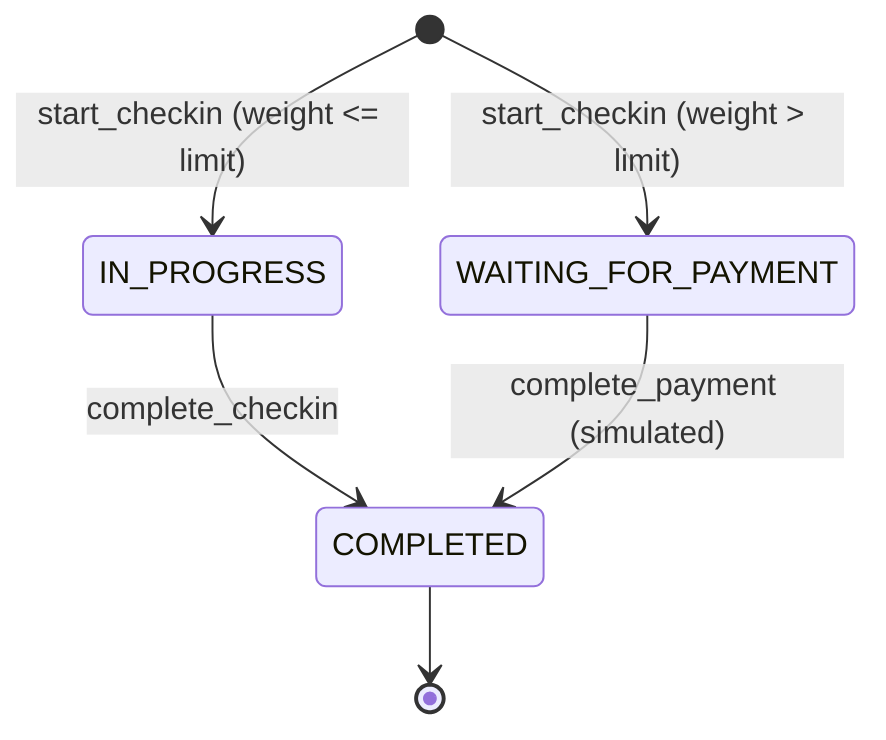
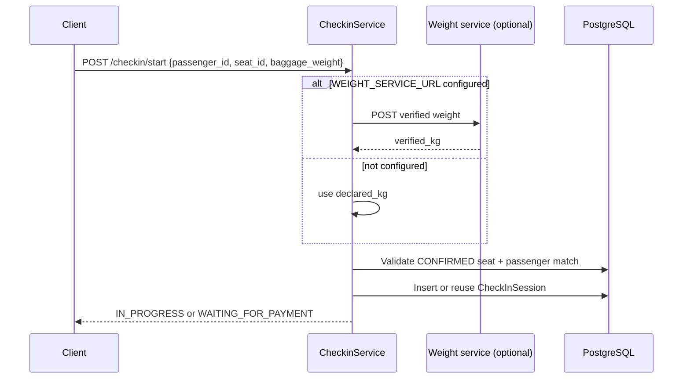
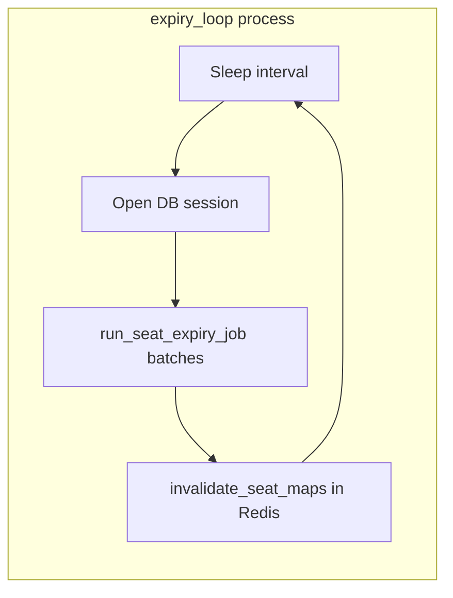
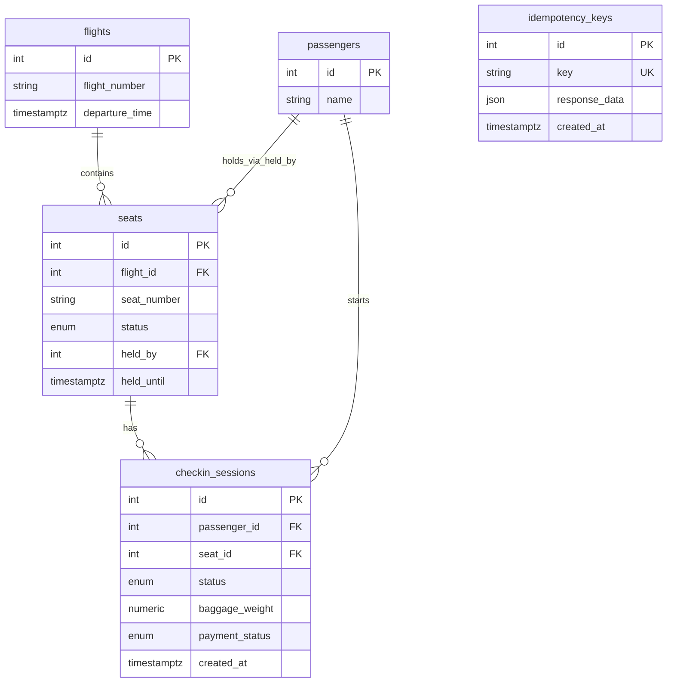

# Workflow design

This document explains how primary features are implemented in code: main flows, concurrency choices, and how data is stored. Diagrams use [Mermaid](https://mermaid.js.org/) (render in GitHub, VS Code, or any Mermaid-capable viewer).

## 1. Seat map read (cached)

The seat map is **eventually consistent** with Redis: the database remains authoritative; cache is invalidated when seats change.

```mermaid
sequenceDiagram
    participant C as Client
    participant API as FastAPI / SeatService
    participant DB as PostgreSQL
    participant R as Redis

    C->>API: GET /api/v1/flights/{flight_id}/seats
    API->>DB: BEGIN; reset expired HELD for flight (if any); COMMIT
    alt expired rows updated
        API->>R: invalidate seat map key for flight_id
    end
    API->>R: GET seat_map:{flight_id}
    alt cache hit
        R-->>API: JSON seat list
        API-->>C: 200 + seats
    else cache miss
        API->>DB: SELECT seats for flight (ordered)
        API->>R: SETEX seat_map:{flight_id}
        API-->>C: 200 + seats
    end
```

## 2. Hold seat (concurrent-safe + idempotent)

Holding uses a **database transaction** with **`SELECT … FOR UPDATE`** on the seat row so two passengers cannot both pass the “AVAILABLE” check. The same `idempotency_key` returns the stored response if the seat matches.

Optional **Redis lock** (`USE_REDIS_SEAT_LOCK`) reduces thundering herds on hot seats; PostgreSQL locking remains the source of truth.

```mermaid
flowchart TD
    A[POST /seats/{id}/hold] --> B{Optional Redis lock}
    B --> C[BEGIN transaction]
    C --> D[get_or_create idempotency row FOR UPDATE]
    D --> E{response_data already set?}
    E -->|yes| F[Return cached envelope if seat_id matches]
    E -->|no| G[Passenger hold rate limit via Redis]
    G --> H[Load seat FOR UPDATE]
    H --> I{Seat exists?}
    I -->|no| J[404 SeatNotFound]
    I -->|yes| K[Lazy-expire stale HELD if needed]
    K --> L{Status AVAILABLE?}
    L -->|no| M[409 conflict / already held / confirmed]
    L -->|yes| N[Set HELD, held_until, held_by]
    N --> O[Save idempotency response_data]
    O --> P[COMMIT]
    P --> Q[Invalidate seat map in Redis]
    Q --> R[200 HELD + held_until]
```

## 3. Confirm seat

Confirmation requires an active **HELD** seat for the same passenger before `held_until`. Idempotency behaves like hold.

```mermaid
flowchart TD
    A[POST /seats/{id}/confirm] --> B[BEGIN + idempotency FOR UPDATE]
    B --> C{Cached response?}
    C -->|yes| D[Return if seat_id matches]
    C -->|no| E[Seat FOR UPDATE]
    E --> F{CONFIRMED?}
    F -->|yes| G[409 already confirmed]
    F -->|no| H{HELD expired?}
    H -->|same passenger| I[409 SeatHoldExpired]
    H -->|other passenger| J[Reset lazy expiry then 409]
    H -->|active HELD| K{held_by matches?}
    K -->|no| L[409 not your hold]
    K -->|yes| M[Set CONFIRMED; clear hold fields]
    M --> N[Save idempotency; COMMIT]
    N --> O[Invalidate seat map]
    O --> P[200 CONFIRMED]
```

## 4. Check-in flow (baggage + optional payment)

Check-in state lives in **`checkin_sessions`**, separate from `Seat`, so baggage and payment do not overload seat columns.



**Weight resolution:** if `WEIGHT_SERVICE_URL` is unset, declared baggage weight is used. If set, the service POSTs `{"passenger_id","declared_kg"}` and expects `{"verified_kg"}`.



## 5. Background: seat expiry worker

The API **lazily** clears expired holds on seat-map reads per flight. The **expiry worker** runs **batched** `UPDATE … FROM (SELECT … FOR UPDATE SKIP LOCKED)` in PostgreSQL to release stale **HELD** rows system-wide and invalidate affected flight caches.



## 6. Database schema and “state history”

### 6.1 Entity-relationship view



### 6.2 State storage (current state, not event sourcing)

| Concern | Where it lives | Notes |
|---------|----------------|--------|
| Seat inventory | `seats.status`, `held_by`, `held_until` | Single row per seat; **no separate hold history table**. |
| Check-in progress | `checkin_sessions.status`, `payment_status`, `baggage_weight` | Latest session per passenger/seat rules enforced in service. |
| Idempotent API retries | `idempotency_keys.response_data` | Stores last successful hold/confirm payload for a key. |

**There is no dedicated audit/event log table** in this codebase: “history” is implied only through **current row state** and **timestamps** (`checkin_sessions.created_at`, `idempotency_keys.created_at`). For full historical auditing, a separate event or outbox table would be a future extension.

### 6.3 Enumerations (database)

- **`SeatStatus`:** `AVAILABLE`, `HELD`, `CONFIRMED`
- **`CheckInStatus`:** `IN_PROGRESS`, `WAITING_FOR_PAYMENT`, `COMPLETED`
- **`PaymentStatus`:** `PENDING`, `PAID`, `FAILED`

---

See also [API-SPECIFICATION.md](API-SPECIFICATION.md) and [ARCHITECTURE.md](ARCHITECTURE.md).
